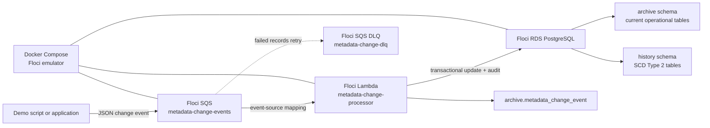

# Digital Archive Metadata PoC

Local proof of concept for archival metadata changes sent as JSON through SQS, processed by a Lambda function, and stored in PostgreSQL. Docker Compose runs [Floci](https://github.com/hectorvent/floci) to provide local AWS-shaped SQS, Lambda, and RDS behavior.

```text
JSON event -> SQS -> Lambda -> PostgreSQL
```

## Data model

### Entity model


```text
Department -> Series -> Record -> Version -> Representation -> File
Consignment -> File
```

Domain tables (current state): `department`, `series`, `record`, `version`, `version_title`, `version_description`, `version_path`, `representation`, `consignment`, `file`, `sensitivity`. Processed event records are stored in `archive.metadata_change_event`.

Titles, descriptions, and paths have UUID primary keys and business keys per version:

```text
UNIQUE (version_id, title_code)
UNIQUE (version_id, description_code)
UNIQUE (version_id, path_code)
```

This supports variants such as `en_1`, `cy_1`, `en_r_1`, and `cy_r_1`. A version stores default codes so the preferred title, description, and path can be resolved quickly.

### Schemas and history

- **`archive`**: current operational tables with normal foreign keys.
- **`history`**: SCD Type 2 history tables for domain entities (`department`, `series`, `record`, `version`, `version_title`, `version_description`, `version_path`, `representation`, `consignment`, `file`, `sensitivity`).

Each history row includes:

```text
valid_from, valid_to, is_current
changed_at, changed_by_id, changed_by_name, change_reason, source_event_id
```

An update is applied in one transaction: the current `archive` row is updated, the previous current `history` row is closed, and a new current `history` row is inserted.

### Sensitivity

`sensitivity` targets exactly one of: `version_id`, `version_title_id`, `version_description_id`, or `version_path_id` (enforced by a check constraint).

Key fields include:

- `sensitivity_type` / `sensitivity_type_code`
- `sensitivity_status` (`active`, `lapsed`, `under investigation`, `superceeded`, `cancelled`)
- `sensitivity_start`, `sensitivity_period`, `sensitivity_rule` (`JAN_AFTER_PERIOD`, `EXACT_PERIOD`, `MANUAL`), `sensitivity_end`
- investigation fields (`investigation_date`, `investigation_outcome`)
- `schedule_reference`, `archivist_note`

For non-`MANUAL` rules, Lambda computes `sensitivity_end` from the start/period/rule; for `MANUAL`, an explicit `sensitivity_end` is required/supplied according to the rules in `lambda/handler.py`. Sensitivity changes are applied like other entities via SQS events and recorded in history/audit.

### Views

Defined in `schema.sql`:

- `archive.current_version_display`: one readable row per version with resolved default title, description, and path.
- `archive.current_active_sensitivity`: sensitivity rows currently considered active for filtering (`sensitivity_status` in `active` or `under investigation`).

Other current-state inspection is done directly against `archive.*` tables.

### Audit

Every accepted event is written to `archive.metadata_change_event`, including entity key/type/ID, change type, outcome, processing status, changed fields, raw JSON payload, actor/reason/source, and timestamps (`changed_at`, `received_at`, `processed_at`). `source_event_id` is unique to support idempotent processing.

## Infrastructure



- The main queue (`metadata-change-events`) receives change messages.
- An enabled SQS-to-Lambda event-source mapping invokes `metadata-change-processor`.
- Lambda applies changes transactionally: it updates `archive` current rows, closes/inserts `history` (SCD Type 2) rows, and records the processed event in `archive.metadata_change_event`.
- Failed records can be retried and are eventually sent to the DLQ (`metadata-change-dlq`) per the queue redrive policy.
- Lambda hot-reload is enabled in `compose.yaml`, so edits under `lambda/` are picked up on invocation without redeploying the function package.

## Local run

### Prerequisites (WSL)

Tested workflow assumes WSL2 (e.g. Ubuntu) with the following installed:

- **Docker** with Compose v2 (`docker compose`) and access to the Docker daemon. Docker Desktop with WSL integration, or Docker Engine running inside WSL, both work. Your user must be able to run Docker commands.
- **AWS CLI v2** (`aws`) for driving Floci’s AWS-compatible APIs.
- **PostgreSQL client** (`psql`) for applying `schema.sql` and inspection queries.
- **jq** for working with JSON events in scripts.
- **Python 3** with `pip` (`python3`, `python3 -m pip`) to install Lambda dependencies into `lambda/vendor`.
- **curl** and **bash** (used by verification/demo scripts).

Example (Ubuntu/Debian, adjust to your environment):

```bash
sudo apt update
sudo apt install -y docker.io docker-compose-v2 awscli postgresql-client jq python3 python3-pip curl
sudo usermod -aG docker "$USER"
# restart your WSL session if you changed docker group membership
```

> Scripts use dummy local credentials from `.env.example`; no real AWS account or credentials are required.

### Environment

`.env.example` defines the local endpoint, dummy AWS credentials, and RDS settings used by the scripts:

```bash
set -a && . ./.env.example && set +a
```

The demo scripts source this file automatically. Key values:

| Variable                                                           | Purpose                                                   |
| ------------------------------------------------------------------ | --------------------------------------------------------- |
| `AWS_ENDPOINT_URL`                                                 | Floci endpoint (`http://localhost:4566`)                  |
| `AWS_DEFAULT_REGION`, `AWS_ACCESS_KEY_ID`, `AWS_SECRET_ACCESS_KEY` | Dummy/local AWS config for CLI                            |
| `LOCAL_RDS_*`                                                      | Local RDS instance/database/user/password used by scripts |

### 1. Create a clean initial state

```bash
./scripts/demo-initial-state.sh
```

This script:

1. Removes previous demo state (Compose/Floci state and labelled local RDS data/volumes).
2. Starts Floci (`compose.yaml`).
3. Creates SQS queues (`metadata-change-events`, `metadata-change-dlq`) with redrive policy.
4. Creates the local RDS PostgreSQL instance and waits for it to become available.
5. Applies `schema.sql`.
6. Installs Lambda runtime dependencies into `lambda/vendor`.
7. Creates the `metadata-change-processor` Lambda (hot-reload from `lambda/`).
8. Seeds initial data by invoking the Lambda once per event in `initial_event.json`.
9. Creates the SQS -> Lambda event-source mapping.

### 2. Inspect the initial state

```bash
./scripts/show-archival-demo.sh
```

The seeded state includes the archival hierarchy (department/series/record/version), title/description/path variants, representation, consignment, file, and an initial sensitivity record.

### 3. Send demo change events

```bash
./scripts/demo-send-three-changes.sh
```

The script prints each JSON message from `events.json` before sending it to SQS:

1. Update the version’s `default_title_code` to `en_r_1`.
2. Update the `en_r_1` title text.
3. Update sensitivity (status/investigation fields) for the seeded sensitivity record.

Notes:

- The caller does not supply `changed_at`. Lambda obtains a single `clock_timestamp()` from PostgreSQL per event and applies it consistently to the current row, history row, and audit record.
- `entity_type` is required alongside `entity_key` so the processor knows which table/rules apply to the keyed entity.

### 4. Inspect results

Wait a few seconds for asynchronous processing, then:

```bash
./scripts/show-archival-demo.sh
```

Expected outcomes (for the provided demo events):

- `archive.current_version_display` reflects the redacted/default title selection and updated text.
- `archive.current_active_sensitivity` is empty after the sensitivity status change moves it out of active/under-investigation states.
- `archive.version_title` shows the updated redacted title text.
- `history.version`, `history.version_title`, and `history.sensitivity` contain closed prior rows and current replacement rows.
- `archive.metadata_change_event` contains the processed SQS events with payload, outcome, and processing metadata.

### 5. Verify the complete flow

```bash
./scripts/verify-demo-flow.sh
```

Read-only checks/evidence:

1. Enabled SQS-to-Lambda event-source mapping.
2. Main queue and DLQ state (empty after successful demo processing).
3. Latest Lambda log stream/output.
4. Current RDS/archive values.
5. SCD Type 2 history counts for version, redacted title, and sensitivity.
6. Processed audit records in `archive.metadata_change_event`.

### Database explorer

Connect with any PostgreSQL client:

| Field    | Value                                                              |
| -------- | ------------------------------------------------------------------ |
| Driver   | PostgreSQL                                                         |
| Host     | `localhost`                                                        |
| Port     | `7001` (or the endpoint port reported for `LOCAL_RDS_INSTANCE_ID`) |
| Database | `metadata_history`                                                 |
| Username | `metadata_admin`                                                   |
| Password | `local-poc-password`                                               |

Useful queries:

```sql
-- Stakeholder views
SELECT * FROM archive.current_version_display;
SELECT * FROM archive.current_active_sensitivity;

-- Audit trail
SELECT * FROM archive.metadata_change_event ORDER BY processed_at;

-- SCD Type 2 history examples
SELECT version_id, default_title_code, valid_from, valid_to, is_current
FROM history.version
ORDER BY valid_from;

SELECT version_title_id, title_code, title_text, valid_from, valid_to, is_current
FROM history.version_title
WHERE version_title_id = '10000000-0000-4000-8000-000000000013'
ORDER BY valid_from;

SELECT sensitivity_id, sensitivity_status, sensitivity_end, valid_from, valid_to, is_current
FROM history.sensitivity
ORDER BY valid_from;
```
