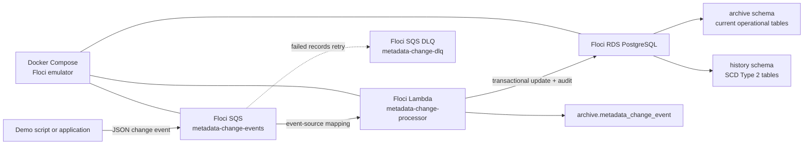
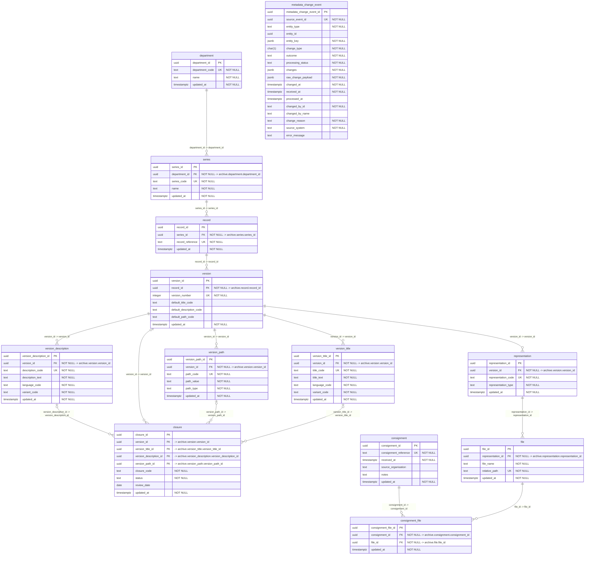

# Digital Archive Metadata PoC

This local proof of concept demonstrates archival metadata changes sent as JSON
through SQS, processed by Lambda, and stored in PostgreSQL. Docker Compose runs
Floci, which provides local AWS-shaped SQS, Lambda, and RDS behavior.

```text
JSON event -> SQS -> Lambda -> PostgreSQL
```

## Infrastructure



The main queue receives the messages. Floci invokes Lambda through the enabled
event-source mapping. Lambda changes the connected current tables in `archive`,
closes/inserts the corresponding SCD rows in `history`, and stores a full event

## Model

```text
Department -> Series -> Record -> Version -> Representation -> File
Consignment -> File
```

The normalized domain tables are:

```text
department, series, record, version
version_title, version_description, version_path
representation, file, consignment, consignment_file
closure, metadata_change_event
```

Titles, descriptions, and paths have both UUID primary keys and business keys:

```text
UNIQUE (version_id, title_code)
UNIQUE (version_id, description_code)
UNIQUE (version_id, path_code)
```

This supports variants such as `en_1`, `cy_1`, `en_r_1`, and `cy_r_1`. A
version stores default codes so the preferred title, description, and path are
quickly available.

## Current And Historical Schemas

`archive` contains current operational tables with normal foreign keys. `history`
contains SCD Type 2 history for every main entity: department, series, record,
version, title, description, path, representation, file, consignment,
consignment-file, and closure.

Each history table has:

```text
valid_from, valid_to, is_current
changed_at, changed_by_id, changed_by_name, change_reason, source_event_id
```

An update changes one `archive` row, closes the prior `history` row, and inserts
a replacement history row in one transaction.

## Closure

There is one `closure` table. It directly targets one version, title,
description, or path by UUID.

```text
closure_code: REDACTED
status:       active | discontinued
review_date:  optional date
```

Closure is updated like every other entity through an SQS `U` event. The demo
starts with an active title closure, then changes it to `discontinued`.

## Views

The model has only two joined stakeholder views:

- `current_version_display`: one readable row per version with its default
  title, description, and path.
- `current_active_closure`: active restrictions only.

It also has simple `current_*` views for the base tables, for quick inspection:

```text
current_department, current_series, current_record, current_version
current_version_title, current_version_description, current_version_path
current_representation, current_file, current_consignment, current_closure
```

## Audit

Every accepted SQS event is written to `metadata_change_event`. It retains the
entity key, entity ID, change type, outcome, processing status, changed fields,
original JSON payload, who changed it, why, source system, and processing times.

## Run

Create a clean initial state:

```bash
./scripts/demo-initial-state.sh
./scripts/show-archival-demo.sh
```

The initial state has one archival hierarchy, title variants, and an active
`REDACTED` closure on the redacted English title.

Send the three SQS changes:

```bash
./scripts/demo-send-three-changes.sh
```

The script prints each complete JSON message before sending it. The events:

1. Change the version default title code to `en_r_1`.
2. Change the `en_r_1` title text.
3. Change the closure status from `active` to `discontinued`.

The caller does not supply `changed_at`. Lambda obtains a single
`clock_timestamp()` value from PostgreSQL while processing each event, then uses
it consistently for the current table, SCD history row, and audit event.

`entity_type` remains required even though every event has `entity_key`:

```text
entity_key  = which logical entity is being changed
entity_type = which table and update rules process that key
```

UUID values alone do not tell a generic processor whether to apply the change
to `archive.version`, `archive.version_title`, or `archive.closure`.

After a few seconds inspect the result:

```bash
./scripts/show-archival-demo.sh
```

Expected results:

- `archive.current_version_display` uses the redacted default title.
- `current_version_title` shows the updated redacted title text.
- `current_active_closure` is empty because the closure is discontinued.
- `metadata_change_event` contains all three auditable events.
- The `history.version`, `history.version_title`, and `history.closure` tables each contain a
  closed historical row and a current replacement row.

## Verify The Complete Flow

After running the three-message demo, run:

```bash
./scripts/verify-demo-flow.sh
```

It is read-only and shows six pieces of evidence:

1. The enabled SQS-to-Lambda event-source mapping.
2. Empty main and DLQ queues after the valid demo events succeed.
3. Latest Lambda CloudWatch-compatible execution log output.
4. Current RDS/archive values.
5. SCD Type 2 history row counts: two rows and one current row for version,
   redacted title, and closure.
6. The three processed SQS audit records in `archive.metadata_change_event`.

## Database Explorer

| Field | Value |
| --- | --- |
| Driver | PostgreSQL |
| Host | `localhost` |
| Port | `7001` |
| Database | `metadata_history` |
| Username | `metadata_admin` |
| Password | `local-poc-password` |

Useful stakeholder query:

```sql
SELECT * FROM archive.current_version_display;
SELECT * FROM archive.current_active_closure;
SELECT * FROM archive.metadata_change_event ORDER BY processed_at;

-- Direct SCD Type 2 history examples
SELECT version_id, default_title_code, valid_from, valid_to, is_current
FROM history.version
ORDER BY valid_from;

SELECT version_title_id, title_text, valid_from, valid_to, is_current
FROM history.version_title
WHERE version_title_id = '10000000-0000-4000-8000-000000000013'
ORDER BY valid_from;

SELECT closure_id, status, valid_from, valid_to, is_current
FROM history.closure
ORDER BY valid_from;
```
