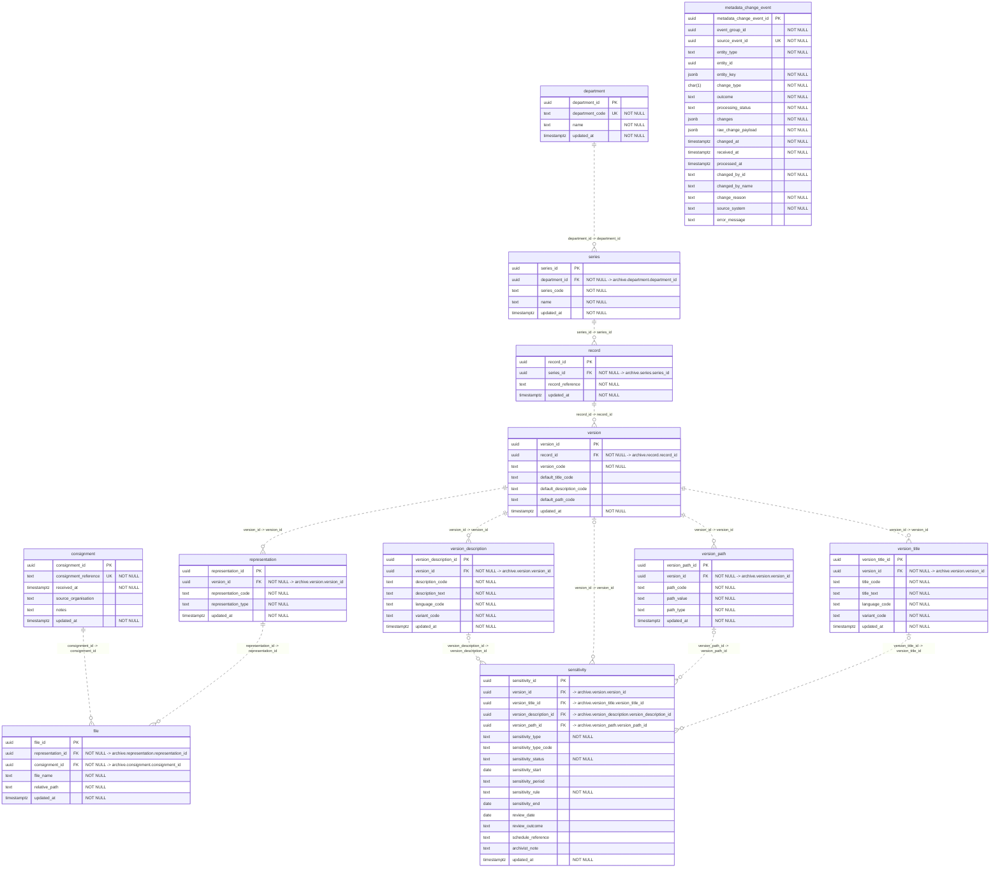
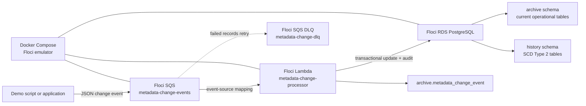

# Digital Archive Metadata PoC

Local proof of concept for archival metadata changes sent as JSON through SQS, processed by a Lambda function, and stored in PostgreSQL. Docker Compose runs [Floci](https://github.com/hectorvent/floci) to provide local AWS-shaped SQS, Lambda, and RDS behavior.

```text
JSON event -> SQS -> Lambda -> PostgreSQL
```

## Project structure

| Path                                  | Purpose                                                        |
| ------------------------------------- | -------------------------------------------------------------- |
| `compose.yaml`                        | Local Floci container with Lambda hot-reload.                  |
| `schema.sql`                          | DDL-only PostgreSQL schema (`archive`, `history`, views).      |
| `events/`                             | Curated fixtures: `seed/`, `lifecycle/`, `bulk/`, `demos/`.    |
| `lambda/handler.py`                   | Metadata change processor (SCD2, audit, batch, `entity_keys`). |
| `lambda/expiry_checker.py`            | Manual sensitivity expiry checker.                             |
| `scripts/demo-initial-state.sh`       | Build infra only (no data).                                    |
| `scripts/reset-demo-data.sh`          | Fast data reset: truncate data, reseed base data.              |
| `scripts/demo-lifecycle.sh`           | Lifecycle demo (resets data by default).                       |
| `scripts/demo-batching.sh`            | Batch/multi-id demo (resets data by default).                  |
| `scripts/demo-expiry.sh`              | Expiry demo (resets data by default).                          |
| `scripts/demo-sqs.sh`                 | SQS async demo (resets data by default).                       |
| `scripts/send-events.sh`              | Generic event sender.                                          |
| `scripts/check-sensitivity-expiry.sh` | Manual expiry checker.                                         |

## Data model

### Entity model



```text
Department -> Series -> Record -> Version -> Representation -> File
Consignment -> File
```

Domain tables (current state): `department`, `series`, `record`, `version`, `version_title`, `version_description`, `version_path`, `representation`, `consignment`, `file`, `sensitivity`. Processed event records are stored in `archive.metadata_change_event`.

Titles, descriptions, and paths have UUID primary keys and business keys per version:

```text
UNIQUE (version_id, title_code)
UNIQUE (version_id, description_code)
UNIQUE (version_id, path_code)
```

This supports variants such as `en_1`, `cy_1`, `en_r_1`, and `cy_r_1`. A version stores default codes so the preferred title, description, and path can be resolved quickly.

### Schemas and history

- **`archive`**: current operational tables with normal foreign keys.
- **`history`**: SCD Type 2 history tables for domain entities (`department`, `series`, `record`, `version`, `version_title`, `version_description`, `version_path`, `representation`, `consignment`, `file`, `sensitivity`).

Each history row includes:

```text
valid_from, valid_to, is_current
changed_at, changed_by_id, changed_by_name, change_reason, source_event_id
```

An update is applied in one transaction: the current `archive` row is updated, the previous current `history` row is closed, and a new current `history` row is inserted.

### Sensitivity

`sensitivity` targets exactly one of: `version_id`, `version_title_id`, `version_description_id`, or `version_path_id` (enforced by a check constraint). Stored fields are source of truth; exposure is derived (not writable).

Key fields include:

- `sensitivity_type` / `sensitivity_type_code` (`FOIA`, `AUR`, `Retained`, `not crown copyright`, `commercial`, `do not publish`)
- `sensitivity_status` (`active`, `internal_review`, `advisory_council_review`, `superceeded`, `cancelled`, `expired`) - restricting: `active|internal_review|advisory_council_review`; non-restricting: `expired|cancelled|superceeded`
- `sensitivity_start`, `sensitivity_period`, `sensitivity_rule` (`JAN_AFTER_PERIOD`, `EXACT_PERIOD`, `MANUAL`), `sensitivity_end`
- review fields (`review_date`, `review_outcome`) - while under `internal_review`/`advisory_council_review`, keep `null`; set on next outcome status (`active`/`cancelled`)
- `schedule_reference`, `archivist_note`

For non-`MANUAL` rules, Lambda computes `sensitivity_end` from start+period+rule (if derived date is exactly `YYYY-01-01`, `JAN_AFTER_PERIOD` moves to `YYYY+1-01-01`). Events must not supply `sensitivity_end` for automatic rules. For `MANUAL` (or changing to `MANUAL`), events must explicitly supply `sensitivity_end` (`date` or `null`).

Derived exposure is shown only in `archive.current_version_display.sensitivity_exposure` (version scope, existing `version/title/description/path` targets only): `OPEN` = no restricting sensitivities; `PARTIALLY_OPEN` = restricting + >=1 unrestricted sibling target; `CLOSED` = restricting and no unrestricted sibling target. `do not publish` is restricting when active/internal_review/advisory_council_review (derived `CLOSED` by current PoC decision).

Manual expiry checker (no cron): `./scripts/check-sensitivity-expiry.sh` finds active sensitivities past `sensitivity_end` and emits deterministic idempotent events setting `sensitivity_status='expired'`. See `SENSITIVITY_LIFECYCLE.md` and `events/`.

### Views

Defined in `schema.sql`:

- `archive.current_version_display`: one readable row per version with resolved default title/description/path and derived `sensitivity_exposure` (`OPEN|PARTIALLY_OPEN|CLOSED`).
- `archive.current_active_sensitivity`: sensitivity rows currently considered active for filtering (`sensitivity_status` in `active`, `internal_review`, or `advisory_council_review`).

Other current-state inspection is done directly against `archive.*` tables.

### Audit

Every accepted event is written to `archive.metadata_change_event`, including entity key/type/ID, change type, outcome, processing status, changes, raw JSON payload, actor/reason/source, timestamps, and `event_group_id`. Lambda returns `event_group_id` for quick audit lookup; `source_event_id` is Lambda-generated, deterministic, and unique for idempotent processing.

## Infrastructure



- The main queue (`metadata-change-events`) receives change messages.
- An enabled SQS-to-Lambda event-source mapping invokes `metadata-change-processor`.
- Lambda applies changes transactionally: it updates `archive` current rows, closes/inserts `history` (SCD Type 2) rows, and records the processed event in `archive.metadata_change_event`.
- Failed records can be retried and are eventually sent to the DLQ (`metadata-change-dlq`) per the queue redrive policy.
- Lambda hot-reload is enabled in `compose.yaml`, so edits under `lambda/` are picked up on invocation without redeploying the function package.

## Local run

### Prerequisites (WSL)

Tested workflow assumes WSL2 (e.g. Ubuntu) with the following installed:

- **Docker** with Compose v2 (`docker compose`) and access to the Docker daemon. Docker Desktop with WSL integration, or Docker Engine running inside WSL, both work. Your user must be able to run Docker commands.
- **AWS CLI v2** (`aws`) for driving Floci’s AWS-compatible APIs.
- **PostgreSQL client** (`psql`) for applying `schema.sql` and inspection queries.
- **jq** for working with JSON events in scripts.
- **Python 3** with `pip` (`python3`, `python3 -m pip`) to install Lambda dependencies into `lambda/vendor`.
- **curl** and **bash** (used by verification/demo scripts).

Example (Ubuntu/Debian, adjust to your environment):

```bash
sudo apt update
sudo apt install -y docker.io docker-compose-v2 awscli postgresql-client jq python3 python3-pip curl
sudo usermod -aG docker "$USER"
# restart your WSL session if you changed docker group membership
```

> Scripts use dummy local credentials from `.env.example`; no real AWS account or credentials are required.

### Environment

`.env.example` defines the local endpoint, dummy AWS credentials, and RDS settings used by the scripts:

```bash
set -a && . ./.env.example && set +a
```

The demo scripts source this file automatically. Key values:

| Variable                                                           | Purpose                                                   |
| ------------------------------------------------------------------ | --------------------------------------------------------- |
| `AWS_ENDPOINT_URL`                                                 | Floci endpoint (`http://localhost:4566`)                  |
| `AWS_DEFAULT_REGION`, `AWS_ACCESS_KEY_ID`, `AWS_SECRET_ACCESS_KEY` | Dummy/local AWS config for CLI                            |
| `LOCAL_RDS_*`                                                      | Local RDS instance/database/user/password used by scripts |

### 1. Build infrastructure (once)

```bash
./scripts/demo-initial-state.sh
```

Resets Floci/RDS, applies `schema.sql`, creates Lambdas/SQS mapping. No data seeded.

### 2. Run curated demos

Each demo resets DB data by default (truncate data + seed base data), no container rebuild, and is self-explanatory: prints exact JSON, invokes/sends it, shows focused DB tables, pauses between stages.

```bash
./scripts/demo-lifecycle.sh   # sensitivity lifecycle: review/ACR/release/AUR+DNP, exposure, SCD2
./scripts/demo-batching.sh    # batch wrapper + entity_keys same-change, audit/row evidence
./scripts/demo-expiry.sh      # past-end active sensitivity, manual expiry checker, idempotent rerun
./scripts/demo-sqs.sh         # async SQS -> Lambda mapping, queue attrs, resulting DB state
```

Add `--no-reset` to keep current DB state. `./scripts/reset-demo-data.sh` does data-only reset. `./scripts/send-events.sh <file> [lambda|sqs]` for ad-hoc files.

### Event payload notes

- Caller does not supply `changed_at`; Lambda uses a single DB `clock_timestamp()` per event for current/history/audit.
- `entity_type` is required with `entity_key`/`entity_keys`. Do not send `event_id`; Lambda returns `event_group_id` for audit lookup and generates deterministic `source_event_id` values for idempotency.
- Bulk: `{"events":[...]}` runs in one invocation/connection with per-event commit and one `event_group_id`. `entity_keys:[...]` expands one logical change to deterministic per-target events (same `event_group_id`, different `source_event_id`). SQS `Records` contract unchanged.

### Database explorer

Connect with any PostgreSQL client:

| Field    | Value                                                              |
| -------- | ------------------------------------------------------------------ |
| Driver   | PostgreSQL                                                         |
| Host     | `localhost`                                                        |
| Port     | `7001` (or the endpoint port reported for `LOCAL_RDS_INSTANCE_ID`) |
| Database | `metadata_history`                                                 |
| Username | `metadata_admin`                                                   |
| Password | `local-poc-password`                                               |

Useful queries:

```sql
-- Stakeholder views
SELECT * FROM archive.current_version_display;
SELECT * FROM archive.current_active_sensitivity;

-- Audit trail
SELECT * FROM archive.metadata_change_event ORDER BY processed_at;

-- SCD Type 2 history examples
SELECT version_id, default_title_code, valid_from, valid_to, is_current
FROM history.version
ORDER BY valid_from;

SELECT version_title_id, title_code, title_text, valid_from, valid_to, is_current
FROM history.version_title
WHERE version_title_id = '10000000-0000-4000-8000-000000000013'
ORDER BY valid_from;

SELECT sensitivity_id, sensitivity_status, sensitivity_end, valid_from, valid_to, is_current
FROM history.sensitivity
ORDER BY valid_from;
```
